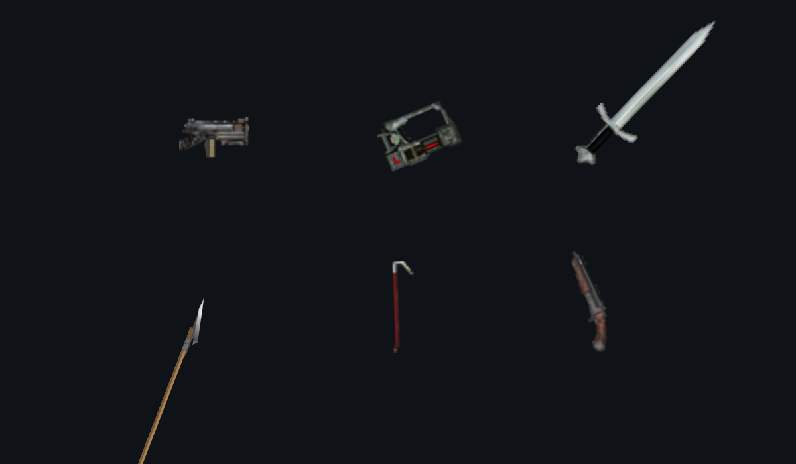
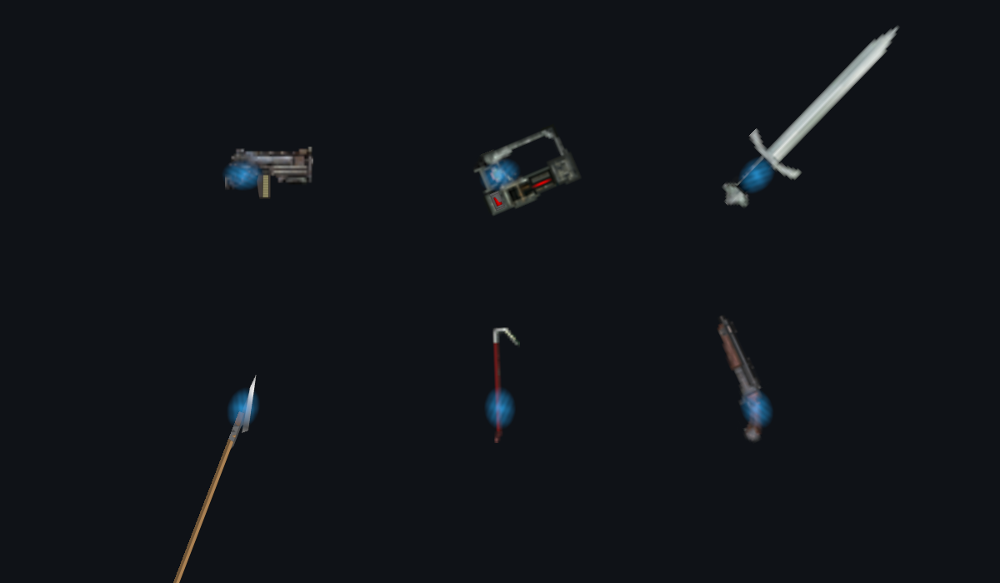

# PT-32: mist at a levitated weapon grip

WeaponView now owns a small, soft magic field at the source holding registration. Each weapon prefab saves a local grip centre and size, editable in the Inspector. The field inherits the actual drawn weapon transform, including reflection, aim, movement and melee swing. Its colour is refreshed from the actor appearance with the other event-driven weapon bindings. Atlas socket weapons do not receive levitation mist. Hiding/unequipping the weapon hides its child field immediately. Gameplay, lights and network messages are unchanged.

The saved profiles use the existing source holding registration `(0, 0)` and a 0.38 × 0.28 m field. This adds a visual effect rather than claiming an exact reconstruction of the original game's particles. `gripCenter` and `gripSize` remain independent of sprite bounds and muzzle coordinates for further art adjustments.

Validation: Unity 6000.0.39f1 on Linux, OpenGLCore/llvmpipe. Run `Remains.Editor.WeaponGripGlowChecks.RunBatch` with graphics enabled. Exit 0; 147 catalog presentations × 2 reflections × 5 angles = 1,470 transform cases, colour changes, 1,000 repeated draws per presentation without recreating sprite/material, release/hide, and actual GPU before/after pixel readback on six weapons. Captures below use actual weapon sprites in an isolated scene; they do not constitute a full gameplay/LAN acceptance run. 153 prefab files include the six extra flight/alternate presentations not enumerated in the held catalog. No Windows/D3D11 or hardware GPU measurements were made.

